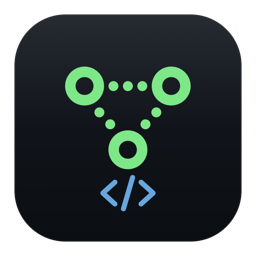
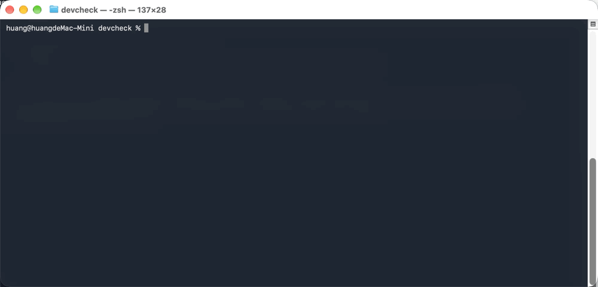
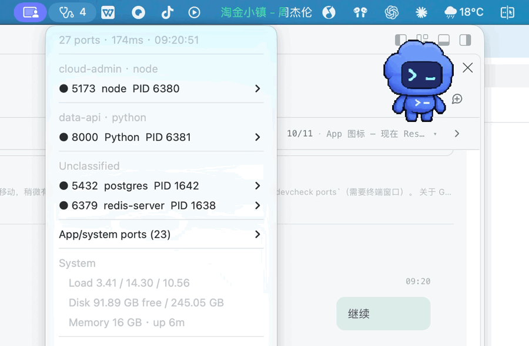

# DevCheck

<p align="center">
  
</p>

**Port 5000 is silently taken by macOS AirPlay. Port 3000 is held by a dev server you forgot about.**

DevCheck is a menu bar port map for macOS: it shows **who holds each port**, **which project it belongs to**, and **what to do about it** — no `sudo`, no telemetry, ~3 seconds.

<p align="center">
  <a href="https://github.com/iihao/devcheck/releases"></a>
  
  
  
  
</p>

<p align="center">
  
</p>

> Bilingual: the CLI and menu bar follow your `LANG` (`DEVCHECK_LANG=en|zh` to force).

## The problem

You run `npm run dev`. It fails. Or it "works" but the browser shows something else. Somewhere on your Mac, 20–30 processes are holding ports:

- an **old dev server** you forgot about
- **AirPlay Receiver** sitting on `5000` (ControlCenter) — the classic silent failure
- a **Docker proxy** you killed with `docker stop` but didn't
- fourteen **GUI apps** (music players, sync clients, IDE helpers) that opened ephemeral ports

`lsof -i :3000` gives you one line of noise. `netstat` gives you no PID. Activity Monitor gives you nothing.

DevCheck answers three questions at once: **what is listening, which project does it belong to, and what should I do about it.**

## What it does

| | |
|---|---|
| 🗺 **Port map** | Every TCP listener → PID → executable → **owning project** (walks up to `package.json` / `pom.xml` / `go.mod` / `.git`) |
| 🔍 **`why <port>`** | Human explanation: "5000 is AirPlay Receiver — turn it off in System Settings, or use 5001" |
| 🚨 **Health rules** | Duplicate listeners on one port, listeners that accept but never answer (fake-alive), runaway CPU |
| 🧹 **Noise filtering** | GUI apps & system daemons are hidden by default (`--all` to see everything) |
| 🖱 **One-click fixes** | Open `http://localhost:port`, copy address, reveal in Finder, `SIGTERM` the process (with confirmation) |
| 🧾 **Zero deps, zero privileges** | Pure Swift + built-in `lsof` / `ps` / BSD sockets. No root, no Full Disk Access, no network calls |

## Install

```bash
brew install --cask iihao/tap/devcheck
# ad-hoc signed (no Developer ID yet) — clear the quarantine flag once:
xattr -dr com.apple.quarantine /Applications/DevCheck.app
```

Or one line, no Homebrew needed:

```bash
curl -fsSL https://raw.githubusercontent.com/iihao/devcheck/main/scripts/install.sh | bash
```

Build from source:

```bash
git clone https://github.com/iihao/devcheck.git
cd devcheck
swift build -c release
./scripts/bundle.sh && open dist/DevCheck.app
```

The app lives in your menu bar only (`LSUIElement`) — no Dock icon, ~60 MB RSS, idle CPU ≈ 0.

## CLI

```bash
devcheck why 5000        # who holds this port, and what to do
devcheck ports           # port map, grouped by project
devcheck ports --json    # machine-readable
devcheck doctor          # full health report
devcheck menu            # render the menu bar content as text
```

<details>
<summary>Example: <code>devcheck why 5000</code></summary>

```
端口 5000：1 个进程占用

  ● ControlCenter  PID 804  [应用/我的]  可达
      程序：/System/Library/CoreServices/ControlCenter.app/Contents/MacOS/ControlCenter

  说明：5000 是 macOS「隔空播放接收器（AirPlay Receiver）」的默认端口，由 ControlCenter 常驻监听。
  建议：系统设置 → 通用 → 隔空投送与接力 → 关闭「隔空播放接收器」，或把你的服务换到 5001。
```
</details>

<details>
<summary>Example: <code>devcheck doctor</code></summary>

```
监听端口 27 个（我的 2 / 其他用户 0）· 采集耗时 145ms
已隐藏 25 个应用/系统端口，用 --all 查看

[我的服务]
  ● 5432  postgres      PID 1638  [brew]
  ● 6379  redis-server  PID 1634  [brew]
```
</details>

<p align="center">
  
</p>

## Why not just `lsof`?

| | DevCheck | `lsof -i` | Activity Monitor | Paid GUI apps |
|---|---|---|---|---|
| Shows listening ports | ✅ | ✅ | ❌ | ✅ |
| Maps port → **project directory** | ✅ | ❌ | ❌ | ❌ |
| Explains *why* (`why 5000`) | ✅ | ❌ | ❌ | ❌ |
| Filters app/system noise | ✅ | ❌ | — | partly |
| Duplicate / fake-alive detection | ✅ | ❌ | ❌ | ❌ |
| Menu bar, always-on | ✅ | ❌ | — | ✅ |
| Free & open source | ✅ | ✅ | — | ❌ |

## How it works

```
UI (menu bar / CLI)  →  SnapshotBuilder  →  collectors (lsof, ps, BSD socket)
```

- One *snapshot* per refresh: ports + processes + projects + issues + system state. Every UI reads the same immutable value object.
- Reachability is a raw TCP handshake (`connect` + `poll`), **not** an HTTP request — otherwise MySQL/Redis would look "down".
- Health rules are pure functions (`RuleEngine.evaluate(ports:) -> [Issue]`), fully unit-tested.
- See [docs/ARCHITECTURE.md](docs/ARCHITECTURE.md) for the design decisions and the traps we hit (Homebrew's own `.git`, Xcode's `python3` living inside `Python.app`…).

## Privacy

Reads local process metadata only. No network access, no analytics, no crash reporting. The only sockets it opens are loopback TCP handshakes against ports you already own.

## Roadmap

- [x] **English CLI + menu** (i18n, `LANG`-aware)
- [ ] Cross-check `brew services` / `launchctl` / `docker ps` → "declared but not running", "running but unclaimed"
- [ ] Port history & diff ("this port existed yesterday, gone today")
- [ ] `libproc` instead of `lsof` for cwd (10× faster refresh)
- [ ] Notarized releases + auto-update
- [ ] Optional privileged helper for root-owned ports

## Contributing

Issues and PRs are welcome — start with [CONTRIBUTING.md](CONTRIBUTING.md). Good first issues are labeled `good first issue`.

## License

[MIT](LICENSE)

---

**中文文档：[README.zh-CN.md](README.zh-CN.md)**

If DevCheck saved you ten minutes of port archaeology, a ⭐ helps the next person find it.