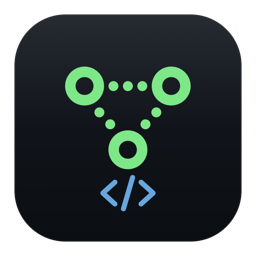
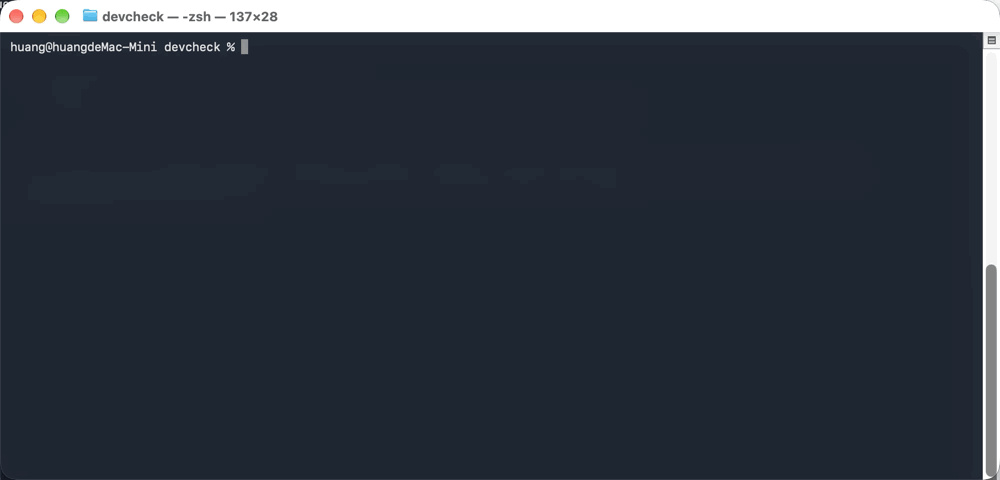
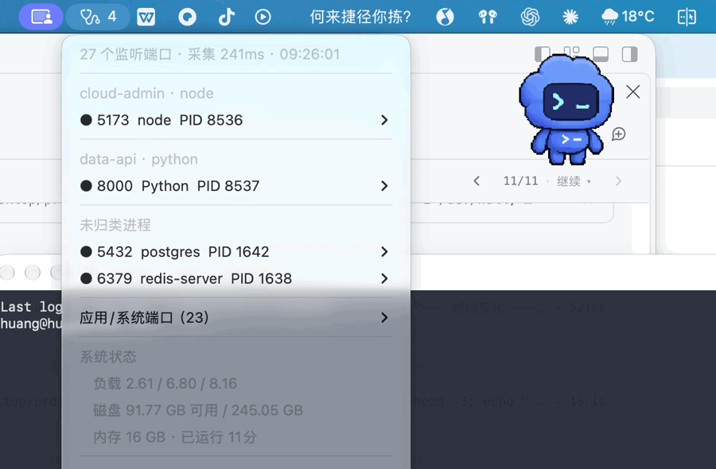

# DevCheck · 工程机体检 + 端口地图

<p align="center">
  
</p>

**5000 被 macOS 的 AirPlay 悄悄占着，3000 是你三天前忘了关的 dev server。**

DevCheck 是一张 Mac 菜单栏端口地图：**谁在占端口**、**它属于哪个项目**、**该怎么处理** —— 不需要 sudo、不联网、3 秒出结果。

<p align="center">
  <a href="https://github.com/iihao/devcheck/releases"></a>
  
  
  
</p>

<p align="center">
  
</p>

<p align="center">
  <code>brew install --cask iihao/tap/devcheck</code> · <a href="#安装">其他安装方式</a>
</p>

> 中英双语：CLI 与菜单栏跟随系统语言，可用 `DEVCHECK_LANG=en|zh` 强制切换。

## 它解决什么

你敲 `npm run dev`，起不来；或者"起来了"但浏览器打开是别的东西。这时你的 Mac 上大概有 20–30 个进程正握着端口：

- 三天前忘了关的**旧 dev server**
- **AirPlay 接收器**静悄悄占着 `5000`（ControlCenter）——最经典的静默失败
- `docker stop` 了但没真的退出的 **Docker 端口代理**
- 十四个**桌面应用**（音乐、同步盘、IDE helper）开的随机端口

`lsof -i :3000` 给你一行噪音，`netstat` 不给你 PID，活动监视器什么也不给你。

DevCheck 一次回答三个问题：**谁在监听、它属于哪个项目、我该怎么办。**

## 能力

| | |
|---|---|
| 🗺 **端口地图** | 每个 TCP 监听 → PID → 可执行文件 → **所属项目**（向上找 `package.json` / `pom.xml` / `go.mod` / `.git`） |
| 🔍 **`why <端口>`** | 人话解释："5000 是 AirPlay 接收器，去系统设置关掉，或者换 5001" |
| 🚨 **体检规则** | 端口被多个进程抢占、监听但握不上手（假活）、单进程 CPU 飙高 |
| 🧹 **噪音过滤** | GUI 应用与系统守护进程默认隐藏（`--all` 查看全部） |
| 🖱 **一键处理** | 打开 `http://localhost:port`、复制地址、Finder 定位、发 SIGTERM（二次确认） |
| 🧾 **零依赖零特权** | 纯 Swift + 系统自带 `lsof` / `ps` / BSD socket。无 root、无"完全磁盘访问"、不联网 |

## 安装

```bash
brew install --cask iihao/tap/devcheck
# 构建是 ad-hoc 签名（暂无 Developer ID），首次启动前清一次隔离标记：
xattr -dr com.apple.quarantine /Applications/DevCheck.app
```

会同时装好菜单栏 App 和 `devcheck` 命令行（已软链进 PATH）。

或者一行搞定，不用 Homebrew：

```bash
curl -fsSL https://raw.githubusercontent.com/iihao/devcheck/main/scripts/install.sh | bash
```

从源码跑：

```bash
git clone https://github.com/iihao/devcheck.git
cd devcheck
swift build -c release
./scripts/bundle.sh && open dist/DevCheck.app
```

只占菜单栏（`LSUIElement`），没有 Dock 图标；常驻内存 ~60MB，空闲 CPU ≈ 0。

## 命令行

```bash
devcheck why 5000        # 某个端口被谁占了、该怎么办
devcheck ports           # 端口地图（按项目分组）
devcheck ports --json    # 给脚本消费
devcheck doctor          # 完整体检报告
devcheck menu            # 把菜单栏内容渲染成文本
```

<details>
<summary>示例：<code>devcheck why 5000</code></summary>

```
端口 5000：1 个进程占用

  ● ControlCenter  PID 804  [应用/我的]  可达
      程序：/System/Library/CoreServices/ControlCenter.app/Contents/MacOS/ControlCenter

  说明：5000 是 macOS「隔空播放接收器（AirPlay Receiver）」的默认端口，由 ControlCenter 常驻监听。
  建议：系统设置 → 通用 → 隔空投送与接力 → 关闭「隔空播放接收器」，或把你的服务换到 5001。
```
</details>

<details>
<summary>示例：<code>devcheck doctor</code></summary>

```
监听端口 27 个（我的 2 / 其他用户 0）· 采集耗时 145ms
已隐藏 25 个应用/系统端口，用 --all 查看

[我的服务]
  ● 5432  postgres      PID 1638  [brew]
  ● 6379  redis-server  PID 1634  [brew]
```
</details>

<p align="center">
  
</p>

## 为什么不用 `lsof` 就够了

| | DevCheck | `lsof -i` | 活动监视器 | 付费 GUI 工具 |
|---|---|---|---|---|
| 列出监听端口 | ✅ | ✅ | ❌ | ✅ |
| 端口 → **项目目录** | ✅ | ❌ | ❌ | ❌ |
| 解释*为什么*（`why 5000`） | ✅ | ❌ | ❌ | ❌ |
| 过滤应用/系统噪音 | ✅ | ❌ | — | 部分 |
| 端口抢占 / 假活检测 | ✅ | ❌ | ❌ | ❌ |
| 菜单栏常驻 | ✅ | ❌ | — | ✅ |
| 免费开源 | ✅ | ✅ | — | ❌ |

## 实现

```
UI（菜单栏 / CLI） → SnapshotBuilder → 采集层（lsof、ps、BSD socket）
```

- 每次刷新产出**一个不可变快照**（端口 + 进程 + 项目 + 告警 + 系统状态），所有 UI 共享。
- 可达性用裸 TCP 握手（`connect` + `poll`）判断，**不是** HTTP 请求——否则 MySQL/Redis 会被误判成挂了。
- 体检规则是纯函数 `RuleEngine.evaluate(ports:) -> [Issue]`，可单测。
- 设计决策与踩过的坑见 [docs/ARCHITECTURE.md](docs/ARCHITECTURE.md)（Homebrew 自己的 `.git`、Xcode 的 `python3` 藏在 `Python.app` 里……）。

## 隐私

只读取本机进程元数据。不联网、不埋点、不上报崩溃。唯一的 socket 是回环 TCP 握手。

## 路线图

- [x] **英文输出（i18n，跟随 `LANG`）**
- [ ] 交叉比对 `brew services` / `launchctl` / `docker ps` →「声明了却没在跑」「在跑但没人声明」
- [ ] 端口历史与 diff（"这个端口昨天还在，今天没了"）
- [ ] 用 `libproc` 替代 `lsof` 取 cwd（刷新快 10 倍）
- [ ] 公证签名 + 自动更新
- [ ] 可选特权 helper，管理 root 端口

## 参与

欢迎 issue / PR，先看 [CONTRIBUTING.md](CONTRIBUTING.md)。适合新手的任务会打 `good first issue` 标签。

## 许可证

[MIT](LICENSE)

---

**English README: [README.md](README.md)**

如果 DevCheck 帮你省下了十分钟的"端口考古"，点个 ⭐ 能让下一个人也找到它。